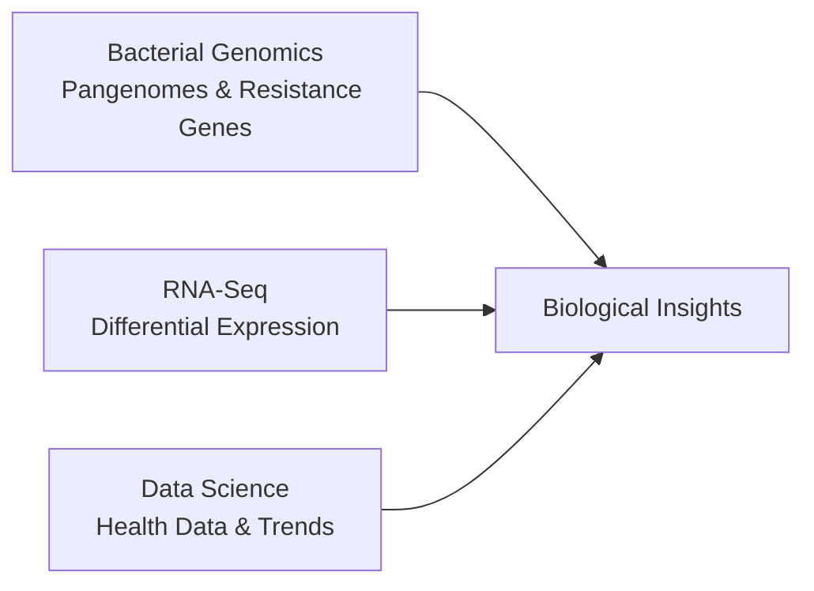

<h1 align="center">Hi, I'm Abdul Rehman 👋</h1>

  <b>Biotechnology Student | Bioinformatics & Data Science</b> 
  Passionate about computational biology, bacterial genomics, and health data analysis.

  
  

---

### About Me

I am a biotechnology student focused on applying programming and data science to biological data. My main areas of interest include:

- **Bacterial Genomics:** Analyzing bacterial genomes, identifying antibiotic resistance genes, and studying pangenomes.
- **RNA-Seq & Transcriptomics:** Processing sequencing data to find differentially expressed genes under different conditions.
- **Data Science:** Cleaning, analyzing, and visualizing public health datasets in Python.

---

### Technical Skills

- **Languages & Tools:** Python, R, Bash, Linux, Git
- **Bioinformatics Tools:** Prokka, Panaroo, ABRicate, FastTree, READemption, DESeq2, segemehl
- **Data Analysis & Visualization:** Pandas, NumPy, Matplotlib, Seaborn, Jupyter Notebook

---

### Featured Projects

- **[Pseudomonas aeruginosa Pangenome Analysis](https://github.com/Abdul3442/pseudomonas-aeruginosa-pangenome-analysis)**  
  Pangenome and antibiotic resistance analysis of *Pseudomonas aeruginosa* isolates using Prokka, Panaroo, and ABRicate.

- **[Salmonella RNA-Seq Pipeline](https://github.com/Abdul3442/RNA-Seq-analysis-of-salmonella-using-READemption-pipeline)**  
  Differential gene expression analysis of *Salmonella enterica* SL1344 using READemption and DESeq2.

- **[Global Tuberculosis Data Analysis](https://github.com/Abdul3442/Python_for_data_sci)**  
  Exploratory data analysis and visualizations of WHO global tuberculosis surveillance data in Python.

---

### Contact

- **LinkedIn:** [abdulrehman2002](https://www.linkedin.com/in/abdulrehman2002/)
- **Email:** [abdulrehman14432@gmail.com](mailto:abdulrehman14432@gmail.com)
